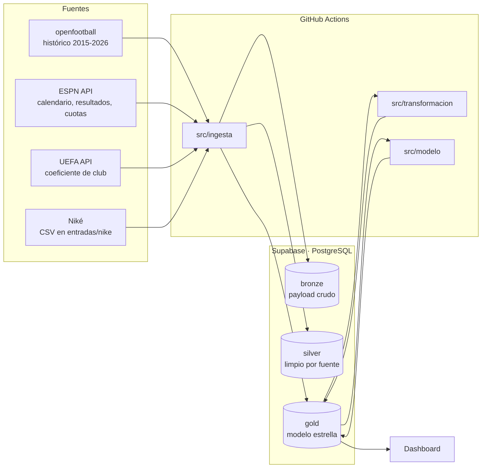

# UCL Data Platform

🇬🇧 [Read in English](README.md)

📊 **Dashboard:** https://choquerutheva-maker.github.io/ucl-data-platform/

Plataforma de datos de la UEFA Champions League, de punta a punta:

- **Ingesta automatizada** de resultados, calendario, cuotas y coeficientes UEFA
  con Python y GitHub Actions.
- **Arquitectura medallion** (bronze → silver → gold) sobre PostgreSQL en Supabase,
  con un modelo estrella en gold.
- **Modelos de pronóstico 1X2** (Dixon-Coles y Elo) evaluados *walk-forward* sin
  leakage y comparados contra el mercado de apuestas.
- **Pronósticos en vivo** desde la jornada 4 de 2026-27, publicados antes de cada
  partido y evaluados contra el mercado (solo en agregado).
- **Dashboard público** en GitHub Pages que lee gold con una clave de solo lectura.

Cobertura: temporadas 2015-16 a 2026-27 (más de 1.500 partidos, 106 clubes).

## Arquitectura



| Capa | Contenido | Acceso |
|---|---|---|
| `bronze` | Respuesta cruda de cada fuente, deduplicada por hash | privado |
| `silver` | Datos limpios por fuente: cuotas ESPN, probabilidades externas, pronósticos de Niké | privado |
| `gold` | Modelo estrella: partidos, llaves, tabla de posiciones, coeficientes, modelos y pronósticos | lectura pública (RLS) |

**Tablas principales de gold**

- Dimensiones: `d_temporada`, `d_ronda`, `d_equipo` (+ `d_equipo_alias` por fuente),
  `d_fecha`, `d_estadio`, `d_fuente`, `d_modelo`, `d_regla_desempate`.
- Hechos: `f_partido` (resultado a los 90', prórroga y penales), `f_serie` (llaves
  ida y vuelta), `f_tabla_posiciones` (foto por jornada, con los criterios de
  desempate de cada formato), `f_coeficiente_uefa`, `f_pronostico`.
- Vistas: `vw_tabla_final`, `vw_evaluacion_pronosticos` y
  `vw_pronostico_vs_mercado` (privada).

## Procesos automáticos

| Workflow | Cuándo | Qué hace |
|---|---|---|
| `captura-cuotas-espn` | cada 3 h | Cuotas 1X2 y Over/Under de las casas que publica ESPN |
| `carga-espn-resultados` | diario 03:30 UTC | Resultados y calendario → tabla de posiciones → pronósticos (backtest y en vivo) |
| `carga-uefa-coeficientes` | manual, una vez por temporada | Coeficiente de club UEFA para el sorteo de cada temporada |
| `carga-nike-pronosticos` | al hacer push de un CSV en `entradas/nike/` | Pronósticos de Niké, con marca de tardío si llegan después del inicio |
| `carga-openfootball` | manual | Histórico 2015-16 .. 2025-26 |
| `calcula-tabla-posiciones` | manual | Recalcula la tabla de cualquier temporada |

Todos los procesos son idempotentes: se pueden volver a correr sin duplicar datos.

## Modelos

| Modelo | Idea |
|---|---|
| **Dixon-Coles v1** | Poisson bivariado con corrección τ para marcadores bajos; ataque y defensa por club con regularización L2 y ponderación temporal (vida media de 365 días). Solo partidos UCL a los 90'. |
| **Dixon-Coles v2** | v1 + coeficiente de club UEFA: `ataque = β·log(coeficiente) + desvío del club`. Un club que debuta parte de lo que predice su coeficiente y no de un equipo promedio. |
| **Elo UCL** | Elo con margen de goles y regresión a la media entre temporadas + logit ordenado para pasar de diferencia de Elo a probabilidades 1X2. |

**Evaluación sin leakage.** Backtest *walk-forward*: cada día de partidos se
pronostica entrenando solo con lo jugado antes. Los hiperparámetros se eligen con
2022-23 y se prueba en 2023-24 a 2025-26 (503 partidos), que no se tocan hasta el final.

| Modelo | Log loss | Brier | Acierto |
|---|---|---|---|
| Frecuencia histórica (baseline) | 1,022 | 0,617 | 49,7 % |
| Elo UCL | 0,942 | 0,556 | 57,3 % |
| Dixon-Coles v1 | 0,935 | 0,551 | 57,9 % |
| **Dixon-Coles v2** | **0,929** | **0,548** | **58,3 %** |

**Contra el mercado.** Frente a la cuota de cierre de ESPN BET sin margen (método
de Shin, 297 partidos de 2024-26), el mercado tiene log loss 0,877: v2 queda
0,050 por encima (IC 95 % +0,017 a +0,081). El mercado incorpora alineaciones y
forma en la liga local, información que estos modelos todavía no tienen.

**En vivo.** Desde la J4 de 2026-27 se publican los pronósticos de Dixon-Coles v2
y Elo antes de cada partido (`gold.f_pronostico`, `es_backtest = FALSE`). Un
pronóstico en vivo no se modifica después del inicio.

## Hallazgos

- **Local y visita, casi parejos en 2020-21.** En la temporada de estadios vacíos
  el local ganó el 40,8 % de los partidos y la visita el 40,0 % (n = 125, todas
  las rondas), frente a 46,7 % y 31,8 % en el resto de 2015-16 a 2023-24
  (n = 994). Es una sola temporada: coincide con la ausencia de público, pero no
  prueba que esa sea la causa.
- **Menos empates desde el nuevo formato.** Los empates bajaron del 21,3 %
  (2015-16 a 2023-24, n = 1.119) al 16,1 % (2024-25 y 2025-26, n = 378;
  p ≈ 0,03), y los goles por partido subieron de 3,00 a 3,35. Todas las rondas a
  los 90'; no incluye 2026-27, que está en curso.

## Limitaciones y próximos pasos

- Los modelos solo ven partidos de Champions. El próximo paso (v3) es sumar las
  5 grandes ligas de Europa, para medir la forma de cada club en su liga y
  pronosticar también esos partidos.
- En partidos muy desparejos los modelos son más extremos que el mercado; falta
  calibrar ese tramo.
- Las cuotas de ESPN no tienen fecha de la línea de cierre: no se puede descartar
  del todo que alguna sea posterior al inicio.

## Estructura

| Ruta | Contenido |
|---|---|
| `sql/ddl/` | Scripts de base de datos, en orden numérico |
| `src/ingesta/` | Captura por fuente (ESPN, openfootball, UEFA, Niké) |
| `src/transformacion/` | Tabla de posiciones por jornada |
| `src/modelo/` | Dixon-Coles, Elo, backtest, benchmark contra el mercado y publicación |
| `seeds/` | Equivalencias de clubes entre fuentes, curadas a mano |
| `entradas/nike/` | Pronósticos de Niké (formato en su README) |
| `docs/` | Dashboard público (GitHub Pages) |
| `.github/workflows/` | Procesos programados |

## Puesta en marcha

1. Crear un proyecto en Supabase y ejecutar `sql/ddl/*.sql` en orden (SQL Editor).
2. En Supabase: *Settings → API → Exposed schemas*, agregar `gold`.
3. En GitHub: *Settings → Secrets → Actions*, crear `DATABASE_URL` con la cadena de
   conexión de Supabase (Session pooler).
4. Correr a mano `carga-openfootball`, `carga-uefa-coeficientes` y
   `carga-espn-resultados`; desde ahí todo es automático.

Sin `DATABASE_URL`, cada script trabaja en local y deja CSV en `data/`:

```
pip install -r requirements.txt
python src/ingesta/openfootball_resultados.py
python src/ingesta/uefa_coeficientes.py
python src/modelo/backtest.py
```

## Fuentes y atribución

El catálogo completo, con licencia y atribución, está en `gold.d_fuente`:
[openfootball](https://github.com/openfootball/football.json) (dominio público),
ESPN y UEFA (APIs públicas sin términos de redistribución). Los datos de fuentes
sin licencia de redistribución se usan solo para calcular variables y agregados;
las cuotas no se republican.

---

Proyecto personal de Ruth Choque, construido con la ayuda de agentes de IA
(PROMETHEUS para datos y modelos, Niké para el análisis futbolístico).
