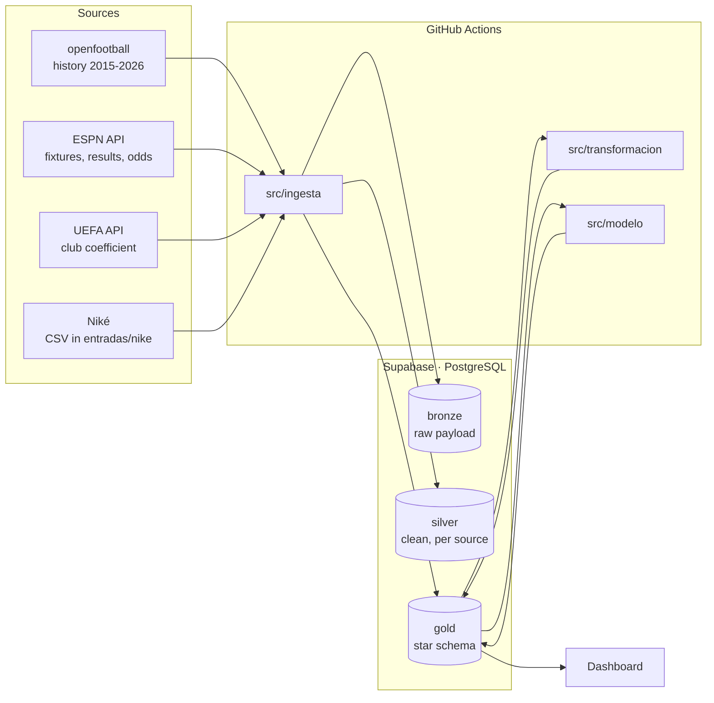

# UCL Data Platform

🇪🇸 [Leer en español](README.es.md)

📊 **Dashboard:** https://choquerutheva-maker.github.io/ucl-data-platform/

An end-to-end data platform for the UEFA Champions League:

- **Automated ingestion** of results, fixtures, betting odds and UEFA coefficients
  with Python and GitHub Actions.
- **Medallion architecture** (bronze → silver → gold) on PostgreSQL (Supabase),
  with a star schema in gold.
- **1X2 forecasting models** (Dixon-Coles and Elo) evaluated with a walk-forward
  backtest (no leakage) and benchmarked against the betting market.
- **Live forecasts** since matchday 4 of 2026-27, published before every match and
  evaluated against the market (aggregates only).
- **Public dashboard** on GitHub Pages, reading gold with a read-only key.

Coverage: seasons 2015-16 to 2026-27 (1,500+ matches, 106 clubs).

## Architecture



| Layer | Content | Access |
|---|---|---|
| `bronze` | Raw response from each source, deduplicated by hash | private |
| `silver` | Clean data per source: ESPN odds, external probabilities, Niké's forecasts | private |
| `gold` | Star schema: matches, two-legged ties, standings, coefficients, models and forecasts | public read-only (RLS) |

**Main gold tables** (names are in Spanish)

- Dimensions: `d_temporada` (season), `d_ronda` (round), `d_equipo` (club, plus
  `d_equipo_alias` per source), `d_fecha` (date), `d_estadio` (stadium),
  `d_fuente` (source), `d_modelo` (model), `d_regla_desempate` (tie-break rules).
- Facts: `f_partido` (match: 90' result, extra time and penalties), `f_serie`
  (two-legged ties), `f_tabla_posiciones` (standings snapshot per matchday, with
  each format's tie-break criteria), `f_coeficiente_uefa`, `f_pronostico` (forecast).
- Views: `vw_tabla_final`, `vw_evaluacion_pronosticos`, `vw_dash_*` (dashboard
  contract) and `vw_pronostico_vs_mercado` (private).

## Automated pipelines

| Workflow | When | What it does |
|---|---|---|
| `captura-cuotas-espn` | every 3 h | 1X2 and Over/Under odds from the bookmakers ESPN publishes |
| `carga-espn-resultados` | daily 03:30 UTC | Results and fixtures → standings → forecasts (backtest and live) |
| `carga-uefa-coeficientes` | manual, once per season | UEFA club coefficient used for each season's draw |
| `carga-nike-pronosticos` | on push of a CSV to `entradas/nike/` | Niké's forecasts, flagged as late if they arrive after kickoff |
| `carga-openfootball` | manual | History 2015-16 .. 2025-26 |
| `calcula-tabla-posiciones` | manual | Recomputes the standings of any season |

Every pipeline is idempotent: it can be re-run without duplicating data.

## Models

| Model | Idea |
|---|---|
| **Dixon-Coles v1** | Bivariate Poisson with the τ correction for low scores; attack and defence per club with L2 regularization and time decay (365-day half-life). UCL matches only, 90' results. |
| **Dixon-Coles v2** | v1 + UEFA club coefficient: `attack = β·log(coefficient) + club deviation`. A debutant club starts from what its coefficient predicts instead of an average team. |
| **Elo UCL** | Elo with goal margin and regression to the mean between seasons, plus an ordered logit to turn Elo differences into 1X2 probabilities. |

**No leakage.** Walk-forward backtest: each matchday is forecast training only on
matches played before it. Hyperparameters are tuned on 2022-23 and the test set is
2023-24 to 2025-26 (503 matches), untouched until the end.

| Model | Log loss | Brier | Accuracy |
|---|---|---|---|
| Historical frequency (baseline) | 1.022 | 0.617 | 49.7% |
| Elo UCL | 0.942 | 0.556 | 57.3% |
| Dixon-Coles v1 | 0.935 | 0.551 | 57.9% |
| **Dixon-Coles v2** | **0.929** | **0.548** | **58.3%** |

**Against the market.** Compared with ESPN BET closing odds with the margin removed
(Shin's method, 297 matches from 2024-26), the market scores a log loss of 0.877:
v2 is 0.050 higher (95% CI +0.017 to +0.081). The market knows line-ups and
domestic form, information these models don't have yet.

**Live.** Since matchday 4 of 2026-27, Dixon-Coles v2 and Elo forecasts are
published before every match (`gold.f_pronostico`, `es_backtest = FALSE`). A live
forecast is never modified after kickoff.

## Findings

- **Home and away almost even in 2020-21.** In the empty-stadium season, home
  teams won 40.8% of matches and away teams 40.0% (n = 125, all rounds), versus
  46.7% and 31.8% in the rest of 2015-16 to 2023-24 (n = 994). It is a single
  season: it coincides with the absence of fans, but does not prove that was the
  cause.
- **Fewer draws since the new format.** Draws fell from 21.3% (2015-16 to 2023-24,
  n = 1,119) to 16.1% (2024-25 and 2025-26, n = 378; p ≈ 0.03), and goals per
  match rose from 3.00 to 3.35. All rounds, 90' results; 2026-27 is excluded
  because it is in progress.

## Limitations and next steps

- The models only see Champions League matches. The next step (v3) is adding
  Europe's top 5 leagues, to capture each club's domestic form and forecast those
  matches too.
- In very lopsided matches the models are more extreme than the market; that range
  still needs calibration.
- ESPN odds don't carry a timestamp for the closing line, so it can't be fully
  ruled out that some were captured after kickoff.

## Repository layout

| Path | Content |
|---|---|
| `sql/ddl/` | Database migrations, in numeric order |
| `src/ingesta/` | Ingestion per source (ESPN, openfootball, UEFA, Niké) |
| `src/transformacion/` | Standings per matchday |
| `src/modelo/` | Dixon-Coles, Elo, backtest, market benchmark and publishing |
| `seeds/` | Hand-curated club mappings across sources |
| `entradas/nike/` | Niké's forecasts (format in its README) |
| `docs/` | Public dashboard (GitHub Pages) |
| `.github/workflows/` | Scheduled pipelines |

Code identifiers and comments are in Spanish.

## Getting started

1. Create a Supabase project and run `sql/ddl/*.sql` in order (SQL Editor).
2. In Supabase: *Settings → API → Exposed schemas*, add `gold`.
3. In GitHub: *Settings → Secrets → Actions*, create `DATABASE_URL` with the
   Supabase connection string (Session pooler).
4. Run `carga-openfootball`, `carga-uefa-coeficientes` and `carga-espn-resultados`
   manually once; from then on everything runs on schedule.

Without `DATABASE_URL`, every script runs locally and writes CSV files to `data/`:

```
pip install -r requirements.txt
python src/ingesta/openfootball_resultados.py
python src/ingesta/uefa_coeficientes.py
python src/modelo/backtest.py
```

## Sources and attribution

The full catalogue, with licence and attribution, lives in `gold.d_fuente`:
[openfootball](https://github.com/openfootball/football.json) (public domain),
ESPN and UEFA (public APIs without redistribution terms). Data from sources without
a redistribution licence is only used to compute features and aggregates; betting
odds are never republished.

---

Personal project by Ruth Choque, built with the help of AI agents
(PROMETHEUS for data and models, Niké for football analysis).
